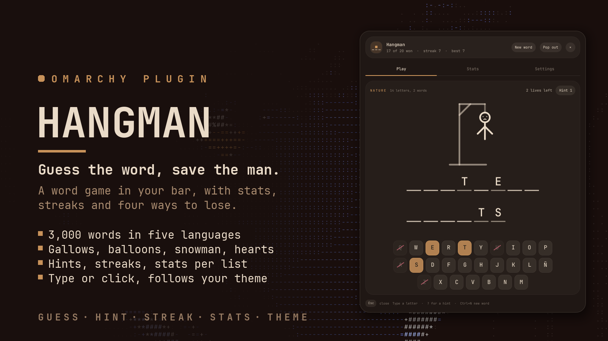
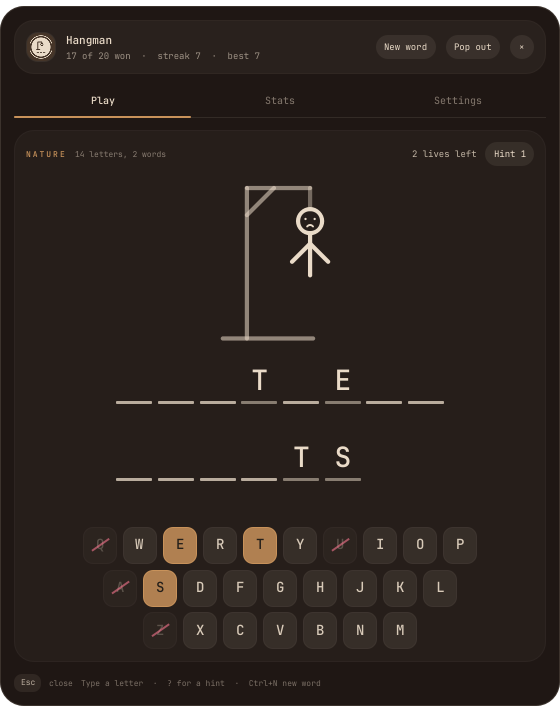
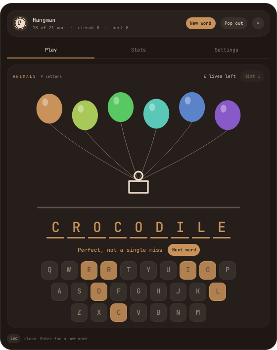
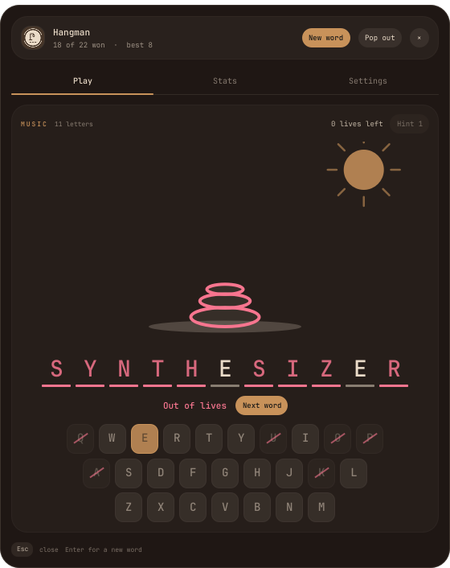
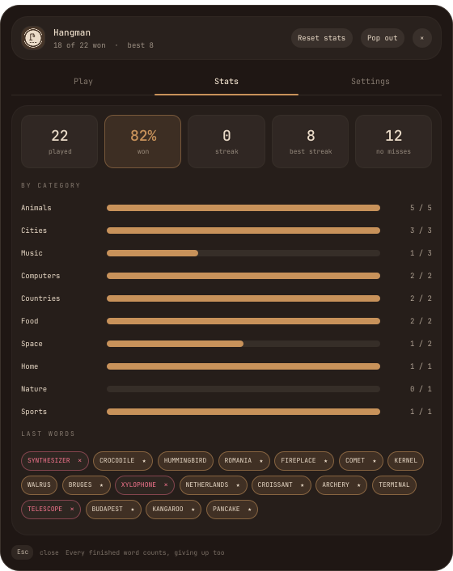
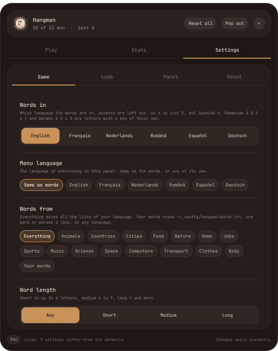
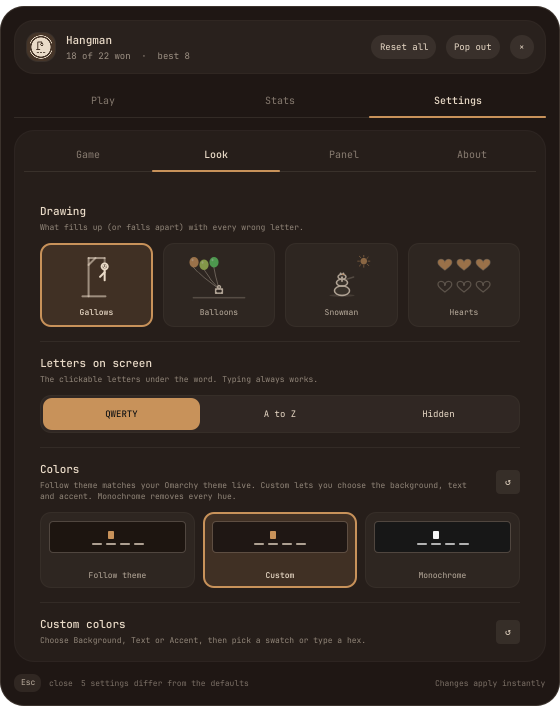
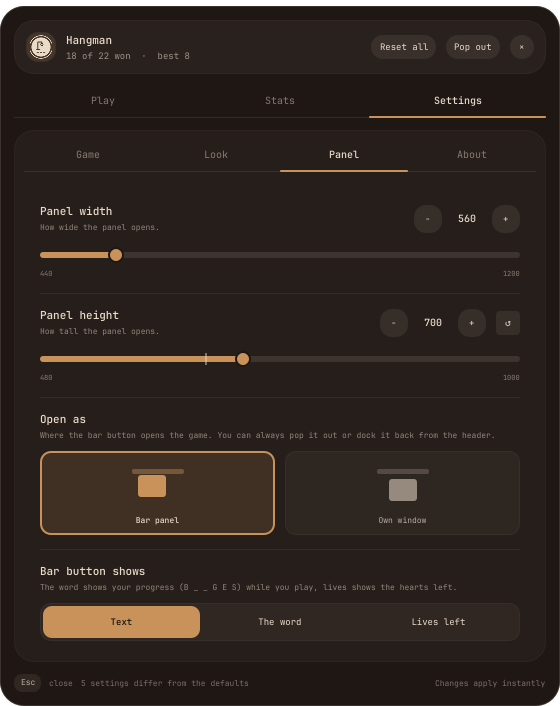

# Hangman

Hangman for the [Omarchy](https://omarchy.org) bar. For the two minutes
while something compiles.



Click the button, type letters, try not to get the man hanged. It keeps your
streak, remembers the word you were on if you close it, and if the gallows
feels too grim there are balloons, a melting snowman or plain hearts instead.

## Why

Uni inspired this one. I wanted to make the game myself. Then I wanted it in
my bar. So I built it as an Omarchy plugin and published it.

## Install

```bash
omarchy plugin add https://github.com/qempexe/omarchy-hangman.git --enable --yes
omarchy restart shell
```

Then put **Hangman** in your bar, from the bar settings or with
`{ "id": "io.github.qempexe.hangman" }` under `bar` → `layout` in
`~/.config/omarchy/shell.json`.

## How to play



- Just **type**. Every letter key is a guess.
- Or click the letters at the bottom, they turn into the accent color when
  they're in the word and get crossed out when they're not.
- **?** uses a hint: it shows a hidden letter but costs a life (it never takes
  your last one).
- **Enter** gets the next word once one is done, **Ctrl+N** skips to a new word
  any time.
- **Esc** closes it. The word stays where you left it.

The clue above the drawing tells you the list the word comes from and how many
letters it has. Phrases like `NORTHERN LIGHTS` wrap between the words.

Skipping a word you haven't touched yet is free. Skipping one you already
started counts as a loss, otherwise the streak would mean nothing.

<br clear="right">

<table>
<tr>
<td></td>
<td></td>
</tr>
<tr>
<td align="center"><sub>no misses, and the letters do a little wave</sub></td>
<td align="center"><sub>out of lives, the rest of the word shows in red</sub></td>
</tr>
</table>

## Four ways to lose


**Gallows** is the classic one. **Balloons** pops one balloon per wrong
letter and the basket drops when the last one goes. The **snowman** loses his
hat, arms and nose and melts into a puddle while the sun gets bigger.
**Hearts** is just your lives, no drama. All four work with any number of lives.

## Words

Fifteen lists: animals, countries, cities, food, nature, home, jobs, sports,
music, science, space, computers, transport, clothes and the body. About 3,000
words, and the same ones in all five languages: English, Français, Nederlands,
Română and Español. `aardvark` in English is `oryctérope` in French, `aardvarken`
in Dutch, `porc-furnicar` in Romanian and `cerdo hormiguero` in Spanish, so
switching language gives you the same game, just in other words. Around 15,000 in
total.

Pick the language and a list (or everything mixed) in the settings, and narrow
it down to short, medium or long words. Words are played without accents, so
`éléphant` is `ELEPHANT`, `bœuf` is `BOEUF`, `șarpe` is `SARPE` and `murciélago`
is `MURCIELAGO`.

The whole panel speaks the same five languages: buttons, settings, stats, even
the name of the game (Hangman, Le Pendu, Galgje, Spânzurătoarea, El ahorcado). By
default it follows the language of the words, or pick a **Menu language** of its
own, say English menus with Romanian words.

Every list is a plain text file in the `words/` folder, with a folder per language
(`en`, `fr`, `nl`, `ro`, `es`) and a file per category: `words/en/animals-en.txt`,
`words/fr/animals-fr.txt`, `words/es/animals-es.txt`, `words/ro/animals-ro.txt`,
and so on.
One word or phrase a line. Want more words, or a word gone? Just edit the file,
it's read again when you switch language or restart the shell.

You can also bring your own. Make `~/.config/hangman/words.txt` with one word or
phrase a line:

```
# lines starting with # are skipped
bruges
waffle iron
cluj-napoca
```

and pick **Your words** in the settings. Accents are dropped (`Brașov` becomes
`BRASOV`), anything that isn't letters, spaces, hyphens or apostrophes is skipped, and it
keeps up to 2000 words. A Spanish list keeps **Ñ**, a letter of its own there. The file is read when the game starts and every time you
pick **Your words** or ask for a new word from it, so no restart needed.

## Stats



Played, win rate, current and best streak, and how many words you got without
a single miss. Then a bar per list, so you can see which one beats you, and your last words with a ★ for the perfect ones.

**Reset stats** in the header clears it all. Click it twice, it asks first.

<br clear="right">

## Settings

Right click the bar button, or the **Settings** tab. Everything applies right
away and lives in `~/.local/state/omarchy-hangman/settings.json`.

<table>
<tr>
<td></td>
<td></td>
<td></td>
</tr>
</table>

**Game**

| Setting | Default | |
| --- | --- | --- |
| Words in | English | English, Français, Nederlands, Română or Español |
| Menu language | Same as words | or English, Français, Nederlands, Română, Español on its own |
| Words from | Everything | one list, all of them, or your words |
| Word length | Any | short (up to 6), medium (6 to 9), long (9+) |
| Lives | 6 | 3 to 10 |
| Hints per word | 1 | 0 to 3, each one costs a life |
| Start with a letter | off | the first letter is filled in for you |
| Category clue | on | show the list above the word |
| Next word right away | off | a new word a moment after you finish one |

Lives, hints and the first letter apply from the next word on. Changing the
list or the length swaps the word straight away if you haven't guessed anything yet.

**Look**

| Setting | Default | |
| --- | --- | --- |
| Drawing | Gallows | gallows, balloons, snowman, hearts |
| Letters on screen | QWERTY | QWERTY, A to Z (with the Ñ key in Spanish), or hidden (typing always works) |
| Colors | Follow theme | your Omarchy theme live, custom, or monochrome |
| Custom colors | | background, text and accent, swatch or hex |
| Spacing, roundness, outline, text size, tint, opacity | | the usual |
| Animation speed | 220 | ms, 0 turns animations off |

**Panel**

| Setting | Default | |
| --- | --- | --- |
| Panel width / height | 560 × 660 | |
| Open as | Bar panel | or its own window (**Pop out** / **Dock** in the header switch it any time) |
| Bar button shows | Text | your text, the word in play (`B _ U _ _ S`), or the lives left |
| Bar button text | Hangman | up to 12 characters |
| Middle click | New word | or nothing |

## From a terminal

```bash
omarchy-shell io.github.qempexe.hangman next       # new word, prints it masked
omarchy-shell io.github.qempexe.hangman status     # word, lives, streak as json
omarchy-shell io.github.qempexe.hangman settings   # open the settings (again to close)
omarchy-shell io.github.qempexe.hangman play       # open the game
```

Bind `settings` or `play` to a key in your Hyprland config if you like, the plugin
doesn't add any keybinds itself.

## Good to know

- A to Z only, plus **Ñ** in Spanish: there it is a letter of its own, never folded
  into an N, and it has its own key on screen. On a keyboard without one, click the
  Ñ key. Accents, `œ` and `ß` are written out. Spaces, hyphens and apostrophes
  (`CHUTE D'EAU`) are shown from the start, you only guess the letters.
- Your stats and the current word are in `~/.local/state/omarchy-hangman/game.json`.
  That folder is only readable by you.
- It only runs `sh` and `head` to read the word files and your words file. No network.
- Popped out, the window manager sizes the window, so width and height only apply
  to the bar panel. The window is titled `Hangman` if you want a rule for it.

## Files

```
qml/
├── Service.qml       settings, the word in play, stats, your words, ipc
├── BarWidget.qml     the bar button
├── core/             SettingsStore, GameStore (game.json), UiState (colors, sizes)
├── panel/            Panel, PopoutWindow, PanelView, PlayView, Figure, LetterCell,
│                     StatsView, SettingsView, SettingRow, TileArt
├── controls/         Btn, Chip, Sw, Txt, TextBox
└── js/               Game.js (the rules), Words.js (reading the lists), Schema.js (settings),
                      Lang.js (every text in the panel, in five languages)
words/                en/, fr/, nl/, ro/, es/, 15 lists in each
tests/test_game.js    node tests/test_game.js
```

## Update or remove

```bash
omarchy plugin update io.github.qempexe.hangman
omarchy restart shell
```

```bash
omarchy plugin remove io.github.qempexe.hangman
omarchy restart shell
rm -rf ~/.local/state/omarchy-hangman ~/.config/hangman   # stats, settings and your words
```

## License

[MIT](LICENSE)
