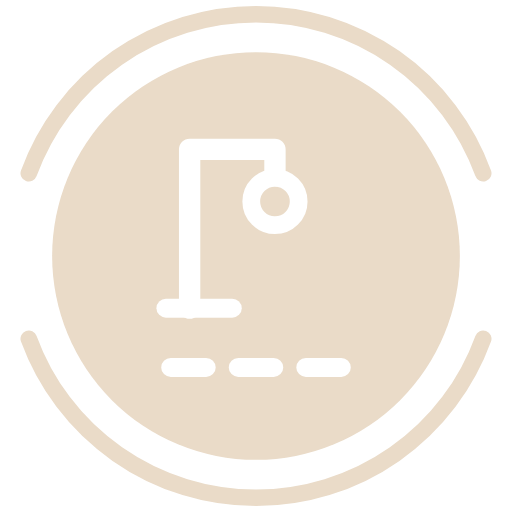
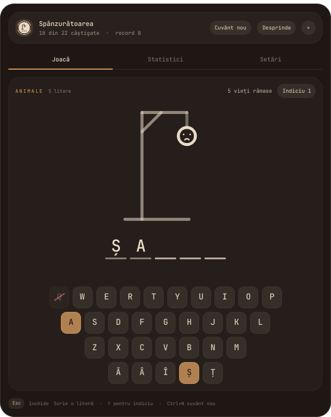
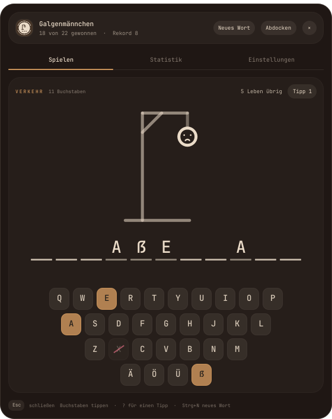
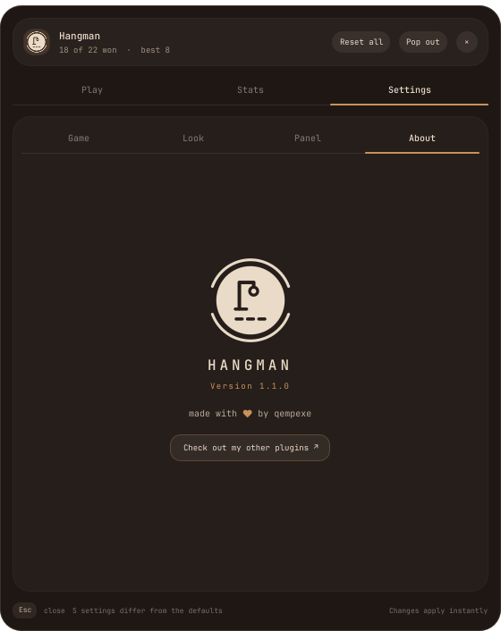

<p align="center">
  <picture>
    <source media="(prefers-color-scheme: light)" srcset="assets/logo-dark.png">
    
  </picture>
</p>

<h1 align="center">Hangman</h1>

<p align="center">Hangman for the <a href="https://omarchy.org">Omarchy</a> bar. For the two minutes while something compiles.</p>


Click the button, type letters, try not to get the man hanged. It keeps your
streak, remembers the word you were on if you close it, and if the gallows
feels too grim there are balloons, a melting snowman or plain hearts instead.

Uni inspired this one. I wanted to make the game myself. Then I wanted it in
my bar. So I built it as an Omarchy plugin and published it.

## Features

- **About 3,000 words in six languages**: English, Français, Nederlands, Română,
  Español and Deutsch, in fifteen lists, or your own words.
- **Letters of their own**: ñ in Spanish, ă â î ș ț in Romanian and ä ö ü ß in
  German are real letters with a key of their own.
- **Four drawings**: gallows, balloons, a melting snowman or plain hearts.
- **Hints, streaks and stats**: per list, with your last words and the perfect ones.
- **Keyboard or mouse**, and a panel that speaks your language.
- **Follows your theme** live, or your own colors, or monochrome.

### How to play


- Just **type**. Every letter key is a guess.
- Or click the letters at the bottom, they turn into the accent color when
  they're in the word and get crossed out when they're not.
- **?** uses a hint: it shows a hidden letter but costs a life (it never takes
  your last one).
- **Enter** gets the next word once one is done, **Ctrl+N** skips to a new word
  any time.
- **Esc** closes it. The word stays where you left it.

The clue above the drawing tells you the list the word comes from and how many
letters it has. Phrases like `NORTHERN LIGHTS` wrap between the words.

Skipping a word you haven't touched yet is free. Skipping one you already
started counts as a loss, otherwise the streak would mean nothing.

<br clear="right">

<table>
<tr>
<td></td>
<td></td>
</tr>
<tr>
<td align="center"><sub>no misses, and the letters do a little wave</sub></td>
<td align="center"><sub>out of lives, the rest of the word shows in red</sub></td>
</tr>
</table>

### Four ways to lose


**Gallows** is the classic one. **Balloons** pops one balloon per wrong
letter and the basket drops when the last one goes. The **snowman** loses his
hat, arms and nose and melts into a puddle while the sun gets bigger.
**Hearts** is just your lives, no drama. All four work with any number of lives.

### Words

Fifteen lists: animals, countries, cities, food, nature, home, jobs, sports,
music, science, space, computers, transport, clothes and the body. About 3,000
words, and the same ones in all six languages. `aardvark` in English is
`oryctérope` in French, `aardvarken` in Dutch, `porc-furnicar` in Romanian,
`cerdo hormiguero` in Spanish and `erdferkel` in German, so switching language
gives you the same game, just in other words. Around 18,000 in total.

Pick the language and a list (or everything mixed) in the settings, and narrow
it down to short, medium or long words.

The whole panel speaks the same six languages: buttons, settings, stats, even
the name of the game (Hangman, Le Pendu, Galgje, Spânzurătoarea, El ahorcado,
Galgenmännchen). By default it follows the language of the words, or pick a
**Menu language** of its own, say English menus with Romanian words.

### Letters

Accents are dropped, so `éléphant` is `ELEPHANT`, `bœuf` is `BOEUF` and
`murciélago` is `MURCIELAGO`. Except for the letters a language has of its own:
those are played as letters, with a key of their own on screen.

| Language | Its own letters | |
| --- | --- | --- |
| Español | Ñ | `año` is `AÑO`, not `ANO` |
| Română | Ă Â Î Ș Ț | `șarpe` is `ȘARPE`, and an old `ş` with a cedilla counts as `ș` |
| Deutsch | Ä Ö Ü ß | `straße` is `STRAẞE`, `käse` is `KÄSE` |

In those languages `S` and `Ș` are two different guesses. On a keyboard without
the letter, click its key.

<table>
<tr>
<td></td>
<td></td>
</tr>
</table>

### Your own words

Make `~/.config/hangman/words.txt` with one word or phrase a line:

```
# lines starting with # are skipped
bruges
waffle iron
cluj-napoca
```

and pick **Your words** in the settings. It's cleaned like the built-in lists, for
the language you play in, so `Brașov` is `BRAȘOV` in Romanian and `BRASOV`
everywhere else. Anything that isn't letters, spaces, hyphens or apostrophes is
skipped, and it keeps up to 2000 words. The file is read when the game starts and
every time you pick **Your words** or ask for a new word from it, so no restart
needed.

### Stats


Played, win rate, current and best streak, and how many words you got without
a single miss. Then a bar per list, so you can see which one beats you, and your
last words with a ★ for the perfect ones.

**Reset stats** in the header clears it all. Click it twice, it asks first.

<br clear="right">

## Installation

```bash
omarchy plugin add https://github.com/qempexe/omarchy-hangman.git --enable --yes
omarchy restart shell
```

Then put **Hangman** in your bar, from the bar settings or with
`{ "id": "io.github.qempexe.hangman" }` under `bar` → `layout` in
`~/.config/omarchy/shell.json`.

## Usage

### Bar button

| Action | Result |
| --- | --- |
| Left click | open the game |
| Right click | open the settings |
| Middle click | a new word (or nothing, in the settings) |

It shows your text, the word in play (`B _ U _ _ S`) or the lives left, as you
pick in the settings.

### Command line

```bash
omarchy-shell io.github.qempexe.hangman next       # new word, prints it masked
omarchy-shell io.github.qempexe.hangman status     # word, lives, streak as json
omarchy-shell io.github.qempexe.hangman settings   # open the settings (again to close)
omarchy-shell io.github.qempexe.hangman play       # open the game
```

Bind `settings` or `play` to a key in your Hyprland config if you like, the plugin
doesn't add any keybinds itself.

## Configuration

The **Settings** tab, or a right click on the bar button. Everything applies right
away and lives in `~/.local/state/omarchy-hangman/settings.json`. **Alt+←** and
**Alt+→** move between Play, Stats and Settings.

<table>
<tr>
<td></td>
<td></td>
</tr>
<tr>
<td></td>
<td></td>
</tr>
</table>

**Game**

| Setting | Default | |
| --- | --- | --- |
| Words in | English | English, Français, Nederlands, Română, Español or Deutsch |
| Menu language | Same as words | or any of the six on its own |
| Words from | Everything | one list, all of them, or your words |
| Word length | Any | short (up to 6), medium (6 to 9), long (9+) |
| Lives | 6 | 3 to 10 |
| Hints per word | 1 | 0 to 3, each one costs a life |
| Start with a letter | off | the first letter is filled in for you |
| Category clue | on | show the list above the word |
| Next word right away | off | a new word a moment after you finish one |

Lives, hints and the first letter apply from the next word on. Changing the
list or the length swaps the word straight away if you haven't guessed anything yet.

**Look**

| Setting | Default | |
| --- | --- | --- |
| Drawing | Gallows | gallows, balloons, snowman, hearts |
| Letters on screen | QWERTY | QWERTY, A to Z, or hidden (typing always works) |
| Colors | Follow theme | your Omarchy theme live, custom, or monochrome |
| Custom colors | | background, text and accent, swatch or hex |
| Spacing, roundness, outline, text size, tint, opacity | | the usual |
| Animation speed | 220 | ms, 0 turns animations off |

**Panel**

| Setting | Default | |
| --- | --- | --- |
| Panel width / height | 560 × 660 | |
| Open as | Bar panel | or its own window (**Pop out** / **Dock** in the header switch it any time) |
| Bar button shows | Text | your text, the word in play, or the lives left |
| Bar button text | Hangman | up to 12 characters |
| Middle click | New word | or nothing |

**About** has the logo, the version and a link to more plugins.

## Troubleshooting

- **Files.** Your stats and the current word are in
  `~/.local/state/omarchy-hangman/game.json`. That folder is only readable by you.
- **Commands.** It only runs `sh` and `head`, to read the word files and your words
  file and to make its state folder, and `xdg-open` for the link in About.
- **Network.** None.
- **A pop-out window has the wrong size.** Popped out, the window manager sizes the
  window, so width and height only apply to the bar panel. The window is titled
  `Hangman` if you want a rule for it.
- **A word in my list doesn't show up.** It has a character that isn't a letter of
  that language, a space, a hyphen or an apostrophe, or it's shorter than 2 or
  longer than 30. Spaces, hyphens and apostrophes (`CHUTE D'EAU`) are shown from
  the start, you only guess the letters.

## Contributing

Bug reports and ideas are welcome as [issues](https://github.com/qempexe/omarchy-hangman/issues).
More words, a new language or a new drawing: [CONTRIBUTING.md](CONTRIBUTING.md)
explains where everything goes and the tests. Everyone taking part is expected to
follow the [code of conduct](CODE_OF_CONDUCT.md). What changed in each version is
in the [changelog](CHANGELOG.md).

### Source layout

```
qml/
├── Service.qml       settings, the word in play, stats, your words, ipc
├── BarWidget.qml     the bar button
├── core/             SettingsStore, GameStore (game.json), UiState (colors, sizes)
├── panel/            Panel, PopoutWindow, PanelView, PlayView, Figure, LetterCell,
│                     StatsView, SettingsView, SettingRow, TileArt, AboutPage
├── controls/         Btn, Chip, Sw, Txt, TextBox
└── js/               Game.js (the rules), Words.js (the lists and the letters),
                      Schema.js (settings), Lang.js (every text in the panel, in six languages)
words/                en/, fr/, nl/, ro/, es/, de/, 15 lists in each
assets/               the logo, light and dark
tests/test_game.js    node tests/test_game.js
```

### Upgrading and uninstalling

```bash
omarchy plugin update io.github.qempexe.hangman
omarchy restart shell
```

```bash
omarchy plugin remove io.github.qempexe.hangman
omarchy restart shell
rm -rf ~/.local/state/omarchy-hangman ~/.config/hangman   # stats, settings and your words
```

## License and credits

[MIT](LICENSE). The Spanish lists and menus are by [pwn27sbx](https://github.com/pwn27sbx).
